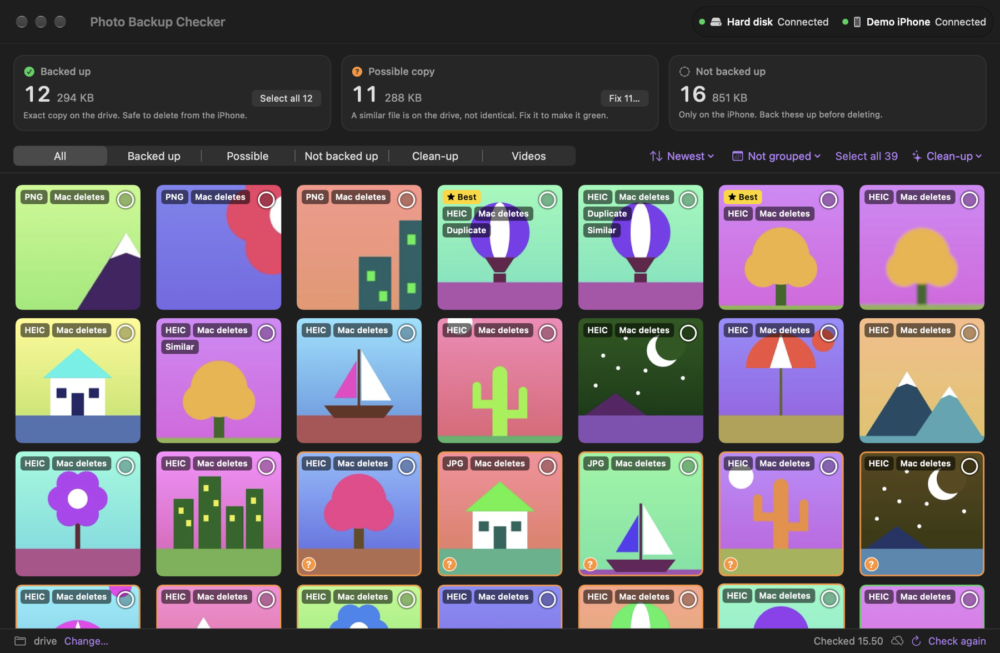
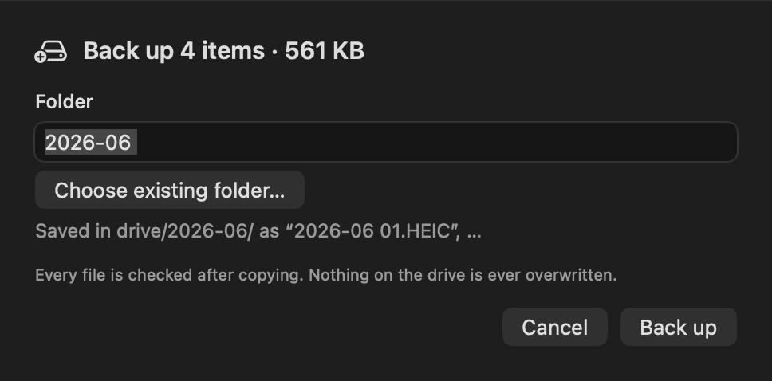
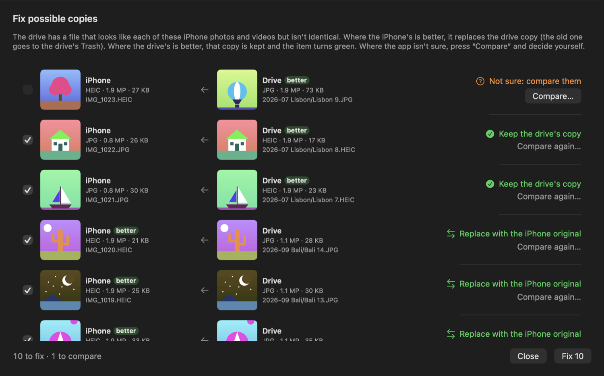
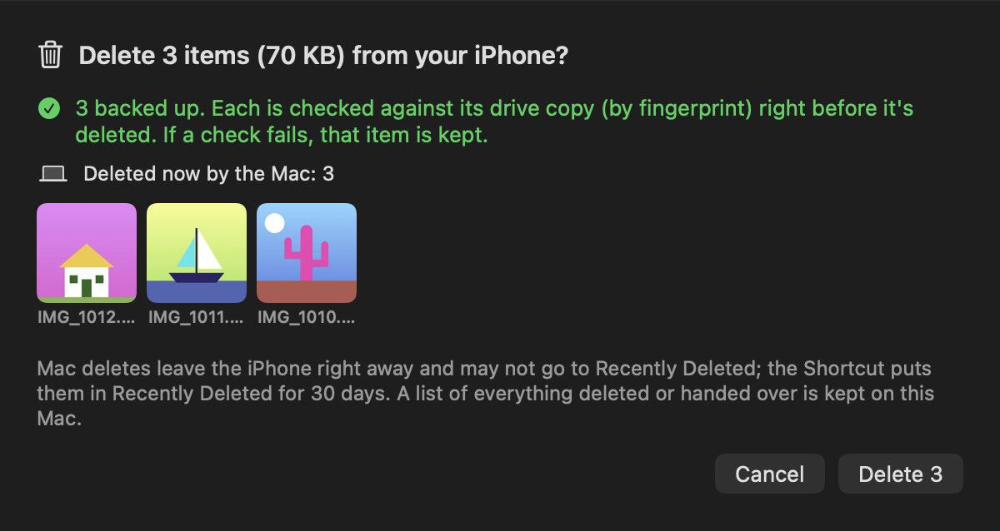

<p align="center">
  
</p>

<h1 align="center">Photo Backup Checker</h1>

<p align="center">
  <b>Know which iPhone photos are safely on your backup drive, before you delete anything.</b>
</p>

<p align="center">
  
  
  
</p>

<p align="center">
  
</p>

Plug in your iPhone, point the app at your backup drive, and every photo and video gets a verdict:

| | Means | Can it be deleted from the iPhone? |
| --- | --- | --- |
| 🟢 **Green border** | An exact copy is on the drive (same bytes, checked by fingerprint) | Yes |
| 🟠 **Amber border** | A probable copy exists (same date and shape, for example a HEIC that was converted to JPG), but it isn't proven identical | Never, until you fix it |
| ⚪ **No border** | Not backed up | Back it up first |

From there the app can **back up** what's missing, **fix** the amber ones, and **delete** from the iPhone only what is safely backed up.

Built for people who aren't technical: the wording in the app is plain English, and never losing a photo comes before everything else.

> [!WARNING]
> **This app is vibe coded.** Almost all of the code was written by an AI coding assistant (Claude Code), steered and tested by a person on a real iPhone and a real backup drive. It has a test suite and strict safety rules, but it has not had a professional code review. Keep a second backup of anything you can't afford to lose, and read the code before you trust it with your photos.

## Take the tour

The pictures below use made-up sample photos, so you can see every screen without plugging anything in.

**1. The check.** Plug in the iPhone and the app sorts everything into three piles: backed up, possible copy, and not backed up.


**2. Backed up.** A green border and tick mean an exact copy is on the drive. Only these can be deleted from the iPhone.


**3. Back up what's missing.** Select photos, press **Back up…**, and name the folder. Every file is checked after copying, and nothing on the drive is ever overwritten.



**4. Fix possible copies.** For each amber photo the app shows the iPhone's version next to the drive's, says which is better, and suggests what to do. Where it isn't sure, you compare them yourself.



**5. Delete from the iPhone.** Each photo is checked against its drive copy one more time, right before it is deleted. If a check fails, that photo is kept. Photos taken with the iPhone camera, and all videos, can only be deleted on the iPhone itself: the app hands their names over and you finish with a one-tap [iPhone Shortcut](https://www.icloud.com/shortcuts/8c90596cf87343ad808163e6098192ea).



**6. Clean up.** Similar shots and exact duplicates are grouped, with a star on the one the app suggests keeping.


## Get started

You need:

- macOS 14 (Sonoma) or later
- Swift 6 toolchain (comes with Xcode 16, or the Command Line Tools: `xcode-select --install`)
- An iPhone connected by USB cable, and an external drive (or any folder) for backups

```sh
git clone https://github.com/MargeryOlethea/photo-backup-checker.git
cd photo-backup-checker
scripts/make-app.sh
```

Open `build/Photo Backup Checker.app`. The app isn't signed by Apple, so the first time, right-click it and choose **Open**.

1. Click **Choose…** and pick the folder on your drive where your photos and videos are kept.
2. Plug in the iPhone, unlock it, and tap **Trust**. The check starts by itself.

The first check reads every matching file once, so it can take a while (about 30–45 minutes for a full phone). Later checks reuse what was learned.

## Try it without an iPhone

```sh
swift scripts/make-demo.swift ~/pbc-demo          # makes a fake phone and drive from the Mac's wallpapers
swift build
PBC_DEMO_PHONE=~/pbc-demo/phone PBC_DEMO_DRIVE=~/pbc-demo/drive .build/debug/PhotoBackupChecker
```

## In the app

Badges: `Live`, `Edited`, `Burst` (several files shown as one), `Duplicate`, `Similar`, and `Probably junk` / `Probably keep` / `Not sure` for screenshots (optional, see below).

<details>
<summary><b>Backing up</b></summary>

Select tiles (click to toggle, double-click to preview), then **Back up…**, and type a folder name like `2026-10 Bali`. Files go into that folder as `Bali 01.HEIC`, `Bali 02.MOV`, … A Live Photo's photo and video share a number.

Existing files are never replaced. Each copy is read back from the drive and compared before it turns green. A hidden `.photo-backup-receipt.json` in the folder records what was copied.

</details>

<details>
<summary><b>Fixing possible copies (amber)</b></summary>

Click **Fix N…** on the Possible copy card, or select some items and click **Fix possible copies…**. Each item is shown next to its drive file, and the app decides by itself when it can:

- **Replace with the iPhone original**: same picture, and the iPhone's is better. The iPhone original takes the drive file's place (`Bali 7.JPG` → `Bali 7.HEIC`). The old file goes to the drive's Trash, never deleted.
- **Keep the drive's copy**: same picture, and the drive's is better. Nothing is copied; the item turns green and the drive's copy counts as its backup. The app re-checks that drive file on every check and right before deleting from the iPhone.
- **Not sure: compare them**: the pictures look different, or it's a video. Press **Compare…** to see both side by side, then **Same** or **Not the same** (the item goes back to "Not backed up" and is included in your next backup).

</details>

<details>
<summary><b>Deleting from the iPhone</b></summary>

Only all-green selections can be deleted. Right before deleting, every copy is checked against the drive again.

The iPhone refuses some deletes from a Mac: any photo that has an edited version, and every video. It reports them as deleted but keeps them. For those, the app copies their names to the clipboard instead, and you run an iPhone Shortcut named **Delete listed photos**.

**[Get the Shortcut](https://www.icloud.com/shortcuts/8c90596cf87343ad808163e6098192ea)**: open the link on your iPhone and tap **Add Shortcut**. Or build it yourself in the Shortcuts app:

1. Get Clipboard
2. Split Text by New Lines
3. Repeat with each item: Find Photos where Name is *Repeat Item*, add to a variable
4. Delete Photos (the variable)

A record of everything deleted or handed to the Shortcut is kept in `~/Library/Application Support/PhotoBackupChecker/deleted-from-iphone.txt`.

</details>

<details>
<summary><b>Screenshot check (optional)</b></summary>

The app can ask TypeSafe's Jev model whether a screenshot is junk or worth keeping, and which of several similar shots is best. It's off unless you add an API key:

```
~/Library/Application Support/PhotoBackupChecker/jev.key
```

With a key, two kinds of pictures are sent to TypeSafe: screenshots (PNG images with an iPhone screen's shape), and pairs of similar photos that Apple's own scoring on the Mac can't separate. Nothing else leaves the Mac. Without a key, nothing is sent at all. Screenshots and photos can contain private information (balances, chats, addresses, faces), so leave the key out if that worries you.

</details>

<details>
<summary><b>Where the app keeps its data</b></summary>

Everything lives in `~/Library/Application Support/PhotoBackupChecker/`: saved fingerprints, thumbnails, your Fix answers, and a `debug.log`. Deleting that folder resets the app; your photos and backups are not touched.

</details>

## Tests

```sh
swift run SelfTest      # prints "ALL CHECKS PASSED (n)"
```

## Contributing

Bug reports and pull requests are welcome. Changes reach `main` only through a reviewed pull request. See [CONTRIBUTING.md](CONTRIBUTING.md).

## License

[MIT](LICENSE)
